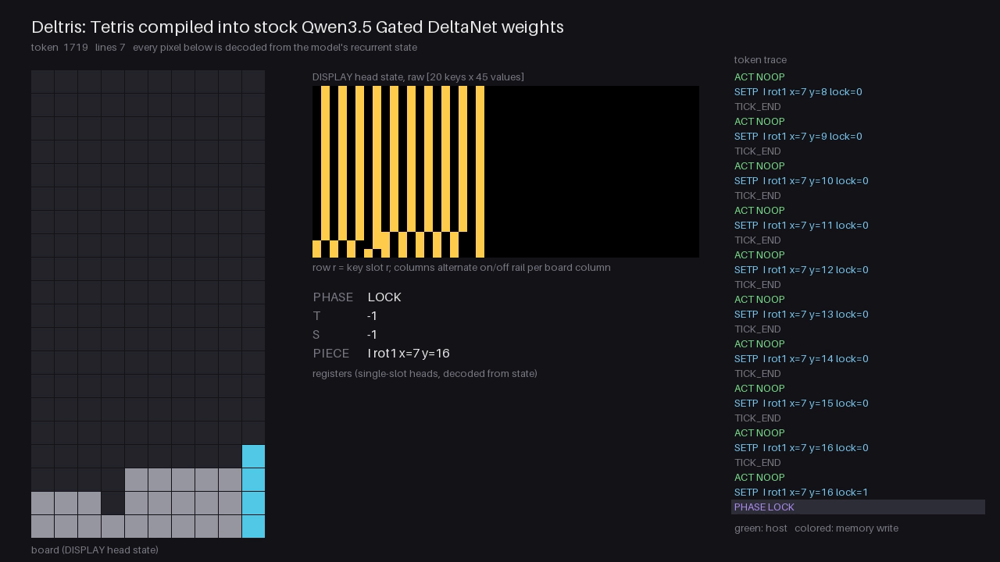
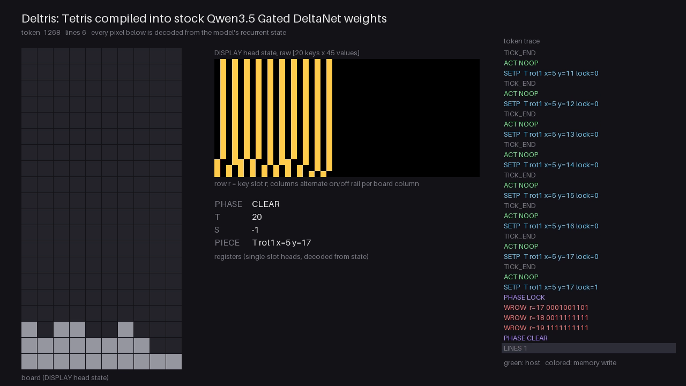
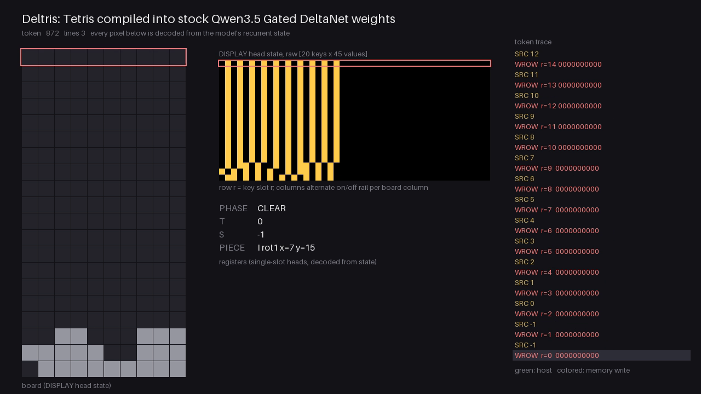

# qwentris

Tetris compiled as a direct circuit into the weights of a Qwen3.5-architecture model. The rules of the game are the circuit: there is no emulated CPU, no instruction set and no ROM between the weights and Tetris, and no weight is trained.

Other projects that compile programs into Qwen3.5 weights build a processor and run software on it (see [Prior work](#prior-work)). Leaving the processor out is the point of this one, and it has four consequences:

- Each DeltaNet head and each MLP unit implements one named game rule, such as "this cell of the piece collides with row 17" or "row 19 is full". The whole construction can be read against the rules of Tetris.
- The board is the recurrent state. Each of the 20 rows is one memory slot, and a dedicated head (DISPLAY) holds all of them in one matrix, so plotting that matrix shows the game. No renderer sits between the state and the picture.
- The conditions that keep the model's output exact in fp32 are written down and tested: a constant residual norm at every token, residual values designed to be 0 or 1, and gates driven far enough to saturate. The residual stream itself carries rounding error of a few parts per million; the exact quantity is the emitted token, which wins the argmax by a wide logit margin.
- Because every weight has a known purpose, the model can serve as ground truth for tests of whether a person or a language model can read, repair or write weights directly (see [Planned use](#planned-use)).

The model class is the stock `Qwen3_5ForCausalLM` from `transformers`, and the saved model loads with `AutoModelForCausalLM` and no custom code. It is not a released Qwen checkpoint and has no language ability; its vocabulary is 35,309 game tokens.



## How a game runs

The game is a stream of tokens. A host program sends two kinds: `PIECE`, which names the next piece, and `ACT`, which carries the player's move for one tick. The model emits every other token by taking the argmax of its output, and those tokens are the game: where the piece is now, which rows to rewrite, how many lines cleared.

Each frame of the recorder has the same four panels. On the left is the board, drawn only from the state of one head (called DISPLAY). The yellow matrix in the middle is that head's raw state, 20 keys by 45 values, where row *r* of the matrix is row *r* of the board. Below it are the registers that hold the falling piece and the current phase. The right column is the token trace, with the host's tokens in green and memory writes in color.

When a piece can't fall further, the model emits `SETP ... lock=1` and enters the LOCK phase, where it rewrites the rows the piece touched with `WROW` tokens. Here row 19 comes out full, so the next token is `LINES 1`:



In the CLEAR phase the model walks up the board from the bottom. For each row it emits `SRC`, the row to copy from, then a `WROW` that writes the copied contents, which shifts the stack down over the cleared lines:



## How the rules become MLP weights

The residual stream is divided into named fields, and every field holds 0s and 1s. A one-hot field such as `cand_x` (the x position a move would go to) has one dimension per label, with exactly one of them set. A dual-rail field stores each bit twice, as *b* and 1−*b*; NOT costs nothing, because reading the second dimension gives the negation. One dimension, ONE, is always 1 and stands in for the bias that the architecture doesn't have.

Qwen3.5's MLP is SwiGLU. Hidden unit *i* computes silu(gate_i · *x*) × (up_i · *x*), and the down projection adds that product back into the residual. Qwentris uses each hidden unit as one logic gate, with gate weights of ±30 and an up weight of 1/30 on ONE. Two fp32 facts make the output exact: silu(30) rounds to exactly 30, so silu(30)/30 = 1.0, and silu(0) = 0. A gate sum of −30 gives silu(−30) ≈ −3×10⁻¹², which is zero as far as the argmax is concerned. A unit therefore outputs 1 when its gate sum is exactly 30 and 0 when the sum is 0 or below, and the compiler sets the gate weights so that the sum reaches 30 only for the inputs the rule names.

Here is one rule from layer 0, printed from the compiled program: "if the action is LEFT and the piece is at x = 4, the candidate x is 3".

| Projection | Weights of this unit |
|---|---|
| gate | +30 on `act=LEFT`, +30 on `piece.x=4`, −30 on ONE |
| up | 1/30 on ONE |
| down | +1 on `cand_x=3` |

When both conditions hold, the gate sum is 30 + 30 − 30 = 30 and the unit writes 1 into `cand_x=3`. With one condition the sum is 0, with neither it is −30, and the unit writes 0. The compiler emits one such unit for each (action, x) pair. Exactly one pair matches on any token, so exactly one label of `cand_x` comes out as 1.

Every rule in the game is one of five unit patterns, each in `qwentris/compiler/primitives.py` with a NumPy reference that the tests compare against:

- **Lookup table**: one unit per input combination, as above. This gives the candidate rotation and x, the piece's cells for each (type, rotation, x), and the board rows a piece occupies.
- **AND of two bits**: gate +30 on *a*, up 1/30 on *b*, so the unit outputs *a* × *b*. It tests, cell by cell, whether the piece and a board row overlap.
- **Threshold on a count**: two units compute [*u* ≥ *t*] = (silu(30(*u* − *t* + 1)) − silu(30(*u* − *t*)))/30 for an integer sum *u* of bits. With *t* equal to the number of inputs it is an AND, and with *t* = 1 it is an OR. "Row 19 is full" is 10 cells ≥ 10, a collision is the OR of 40 cell overlaps, and `LINES k` counts full rows.
- **Multiplexer**: an AND between a one-hot selector and a source. It picks the board rows under the piece using the piece's y, and the new position using the collision bit.
- **Rule table**: the protocol's control flow, meaning which kind of token comes next. Each row is one unit with +30 on each condition that must hold and −30 on each that must not. For example, the row for `kind=PIECE` with `spawn collides` writes `PHASE OVER`.

A unit can read only fields that already exist at its layer's input, so a rule that depends on another rule's output goes one layer later. The compiler puts each primitive in the earliest MLP whose inputs are ready. The longest dependency chain is the move check, and its length is why the model has six layers:

| Layer | Step of the move check |
|---|---|
| 0 | candidate rotation and x from the action (lookup) |
| 1 | the candidate's cells (lookup on type, rotation, x) and the five board rows under the piece (multiplexer on y) |
| 2 | each cell of the candidate AND the board cell under it |
| 3 | collision: OR of the 40 cell overlaps and the out-of-bounds bit |
| 4 | the new position (the candidate, or the old position on a collision) and the lock bit |
| 5 | the fields of the `SETP` token, selected by the input token's kind |

The LM head reads the output fields and gives the correct token a logit of 30.

Two details keep this exact through the whole stack. Every primitive writes into dimensions that no other primitive uses, so the residual's additions never overlap. Every field also has a fixed number of 1s, so the residual norm is the same on every token, and each RMSNorm multiplies by a constant that the compiler folds into the next layer's gate and up weights. `qwentris/build.py` writes the game with these primitives, grouped by layer. Layer 1 uses all 1,860 hidden units, and that count sets the MLP's intermediate size.

## Run it

Requires [uv](https://docs.astral.sh/uv/) and Python 3.11 or later.

```sh
uv sync
uv run python -m qwentris.build models/qwentris
uv run python -m qwentris.play --model models/qwentris --device cpu
```

The build step writes the model directory and prints its shape. The play command opens the game in the terminal: left and right arrows move, up rotates clockwise, down passes the tick, and `q` quits. A CPU is enough to play.

To record a game as an MP4 with the four panels shown above:

```sh
uv sync --group viz
uv run python -m qwentris.record --model models/qwentris --device cuda --out game.mp4
```

The environment must not contain the `fla` or `causal_conv1d` packages. If either is installed, `transformers` runs their kernels in place of its pure-PyTorch DeltaNet code, which is the code the tests check the model against.

## The model

| | |
|---|---|
| Architecture | `Qwen3_5ForCausalLM`, every layer linear attention |
| Layers | 6 |
| Hidden size | 1681 |
| MLP intermediate size | 1860 |
| DeltaNet heads | 25 (20 board rows, DISPLAY, and four registers) |
| Vocabulary | 35,309 tokens |
| Parameters | 219.7M, most of them in the embedding and output head |
| Nonzero parameters | 1,880,041 (0.86%) |
| Size on disk | 838 MB as fp32 safetensors |

The compiler chooses these sizes. Six layers is the depth of the longest logic chain in the game, the one that checks a move for collisions and decides whether the piece locks. The model is small in depth and in nonzero weights; the file is large because the vocabulary has one token for every piece position and every row pattern.

## Limits

- Exactness is tested in fp32 only. bf16 and the optional fused DeltaNet kernels are untested.
- The model loads as a stock class, but running it takes this repository's host loop. Each forward call passes `position_ids` and an attention mask keyed by layer type, and `generate()` raises on a model whose layers are all linear attention (observed with `transformers` 5.22.1).
- The rules are a reduced Tetris: standard piece shapes and rotations with no wall kicks, no hold, no hard drop, and a line count for a score.
- The host chooses the pieces. The model contains no random number generator.

## Tests

```sh
uv run pytest -q tests/
```

The tests cover the reference Tetris engine, the token protocol, each compiler primitive (logic gates, lookup tables, multiplexers, memory), and short games on the compiled model.

The full check is a differential test against the reference engine. It feeds complete games to the model and compares every token the model emits, and the board decoded from its state after every token, with the reference:

```sh
uv run python -m qwentris.difftest --random 10000 --greedy 500 --batch BATCH \
  --model models/qwentris --out games.jsonl --device cuda
```

The token comparison is what checks the game logic. The board comparison checks that writes land in the right memory slot and stay there, since the model never reads the DISPLAY head.

`BATCH` is the number of games per forward pass; set it to what the GPU's memory holds. On a CPU the model runs at a few tokens per second, which is too slow for full games at this count. `PROGRESS.md` records the runs done so far and their results.

## Planned use

Section 7 of `SPEC.md` describes a benchmark that uses this model as a subject. A person or a language model receives the weights and has to answer questions about them (READ), repair a planted fault from one failing trace (FIX), or produce weights from the rules (WRITE). The answers are graded against the construction: a repair is scored on the differential test's pass rate after the edit, on how many weights it changed compared with the known minimal fix, and on whether the edit landed in the right component.

`DECISIONS.md` (D9) adds a ladder of variants that compute the same function while hiding more of the structure, to find which kind of structure a subject depends on.

This repository contains the compiler, the model and its tests. It does not contain the benchmark.

## Prior work

Compiling programs into Qwen3.5 Gated DeltaNet weights, with the recurrent state as addressable memory, comes from [Qwenputer](https://github.com/divagr18/qwenputer). It compiles a RISC-V CPU (and, in an earlier version, a CHIP-8 machine) into layers placed in front of the pretrained Qwen3.5-4B, and runs C and MicroPython on it. This project uses the same memory mechanism: one-hot keys that address rows, with the write gate held at 1.

[nesformer](https://github.com/dbreunig/nesformer) compiles the NES's 6502 CPU, its RAM and a cartridge ROM into a standalone Qwen3.5-architecture checkpoint that loads with no custom code, and reports exact free-running traces of up to 2.6 million tokens in bf16. The host draws the picture from the CPU's execution log. Loading as a standalone stock model is therefore not new here; holding the display in the model's state, and compiling the game without a CPU, are the differences.

[WeightSpaceTetris](https://github.com/dirktheeng/WeightSpaceTetris) implements Tetris as a recurrent threshold network of 1,035 hand-written parameters. It is not a transformer, and its board is the input tensor fed back at each step.

Compilers that target softmax-attention transformers came first: [RASP](https://arxiv.org/abs/2106.06981), [Tracr](https://arxiv.org/abs/2301.05062), [Looped Transformers](https://arxiv.org/abs/2301.13196) and [ALTA](https://arxiv.org/abs/2410.18077).

For the planned benchmark, the nearest work is the set of interpretability benchmarks built on models with known circuits. Tracr discusses compressing the residual stream so that features leave the computational basis, and [InterpBench](https://arxiv.org/abs/2407.14494) trains transformers to implement known circuits so that a trained model has ground truth. The question of whether language models can read and edit weights is posed in [Sparks of Weight-Space Programming](https://rikiyat.github.io/blog/weight-space-programming/), whose subjects are trained networks graded on behaviour.

## Layout

| Path | Contents |
|---|---|
| `qwentris/ref/` | Reference Tetris engine and the token protocol interpreter |
| `qwentris/compiler/` | Primitives and the code that lays them out as model weights |
| `qwentris/build.py` | The Tetris program, written with those primitives |
| `qwentris/play.py`, `record.py`, `difftest.py` | Terminal game, video recorder, differential test |
| `tests/` | Test suite |
| `SPEC.md` | The design: architecture facts, game rules, token protocol, research protocol |
| `DECISIONS.md` | Each place the implementation departs from or fills in the spec, with the reason |
| `paper/` | LaTeX paper; numbers and figures are derived from `results/` |

